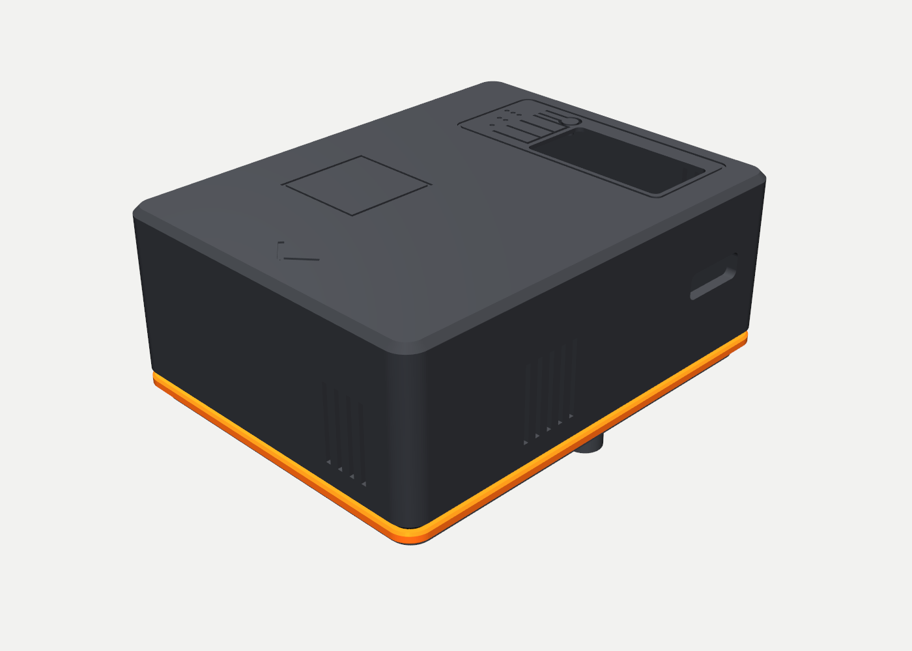
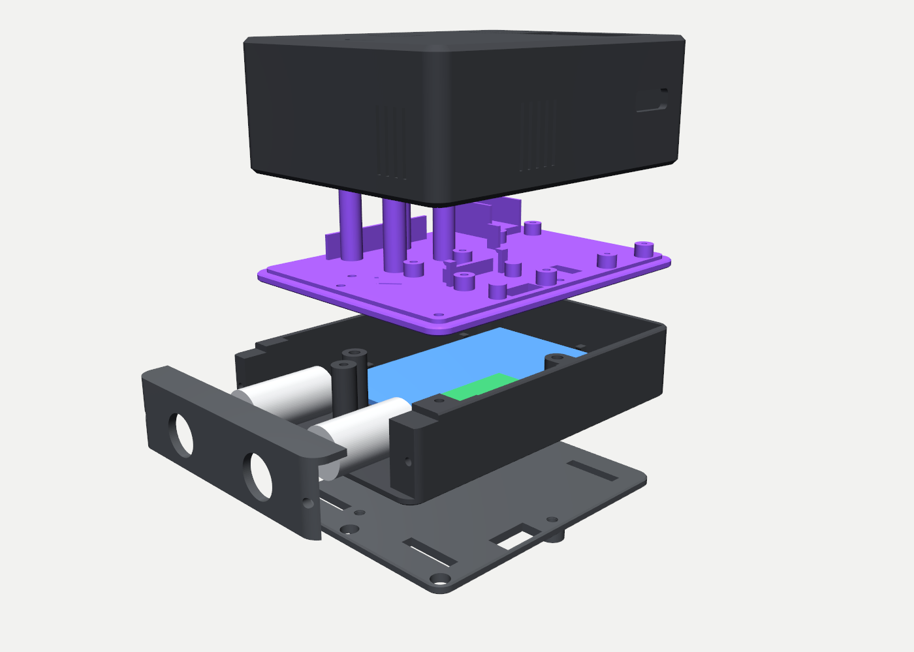

# ESP32 race logger enclosure

3D-printed enclosure for a Feather-based race data logger (ESP32-S3, GPS, IMU, temperature/humidity, OLED), designed for a
GoPro mount on the bench and shakedown car and a 1.75 in roll-bar clamp later. The CAD is generated: one Python file holds
every dimension, validates clearances against the real board files, emits FeatureScript, pushes it to Onshape and exports the
STLs. Everything in this repo (figures, build guide, BOM, renders) is derived from those same constants.

| v1 as printed (GoPro base) | v2 with the analog tray |
|---|---|
|  |  |

Printed in dark gray ASA with a purple accent band (4OGS livery) on a Bambu Lab P1S.

## Status

- **v1** (shell + sled + GoPro base): printed, assembled, in use. Measured corrections from the first print are folded in
  (12.7 mm Feather stacking pitch, button cap heights, IMU hook lips, 3.4 mm insert bores for 3.5 mm OD inserts).
- **v2 analog tray**: a 23.5 mm tray between the sled and the base for two ADS1115 ADCs and a half-size perma-proto
  (signal conditioning), with a removable connector card on a front step. Exported 2026-10-02, printing next. Shell, sled
  and base are reused; every fastener comes from an M2.5 kit.
- **Roll-bar clamp** (saddle + cap, parametric tube diameter): designed, not yet printed; waits for the cage.

## Repo map

| Path | What |
|---|---|
| [`docs/ASSEMBLY.md`](docs/ASSEMBLY.md) | Illustrated build guide: parts, hardware counts, coupon test, assembly order, checks, service, the v2 tray (section 8) |
| [`docs/BOM.md`](docs/BOM.md) | Priced BOM with vendor links and live stock, generated from [`docs/bom.yaml`](docs/bom.yaml) |
| [`docs/assembly/`](docs/assembly/) | Annotated maps (sled, base, shell, tray) drawn from the generator constants, plus the renders used in the guide |
| [`docs/requirements.md`](docs/requirements.md) | The brief: constraints, environment, what must stay visible or reachable |
| [`docs/concepts/`](docs/concepts/) | Concept study (slab / shell+sled / wedge), the review-panel gate and the decision record |
| [`docs/inspection-log.md`](docs/inspection-log.md) | Every design review pass and what it changed, including what the printed parts taught us |
| [`mechanical/generate_onshape.py`](mechanical/generate_onshape.py) | **Source of truth.** Constants, clearance validation, FeatureScript emission, Onshape push, STL export, local CadQuery mirror |
| [`mechanical/enclosure.fs`](mechanical/enclosure.fs) | The generated FeatureScript as last pushed to Onshape (do not edit by hand) |
| [`mechanical/README.md`](mechanical/README.md) | Print table (orientation, supports, settings), hardware table, ports, short assembly order |
| [`mechanical/output/*.stl`](mechanical/output/) | Printable parts, exported from Onshape and checked to be single manifold bodies |
| [`mechanical/output/bambu-labs/`](mechanical/output/bambu-labs/) | Sliced Bambu Studio projects for the shell and sled |
| [`mechanical/output/renders/`](mechanical/output/renders/) | Renders of every part and configuration, sections and zooms |
| [`mechanical/reference/`](mechanical/reference/) | Adafruit Eagle `.brd` and STEP files the layout is derived from, measured stack dimensions, the 4OGS logo |
| [`mechanical/assemble.py`](mechanical/assemble.py) | Builds the Onshape assemblies (enclosure parts + real board models placed per the layout) |
| [`mechanical/render_stl.py`](mechanical/render_stl.py), [`render_v2.py`](mechanical/render_v2.py) | pyvista renders from the STLs |
| [`mechanical/assembly_figures.py`](mechanical/assembly_figures.py) | Draws the annotated maps in `docs/assembly/` |
| [`mechanical/display/`](mechanical/display/) | Sibling project: mount and bench stand for the 7 in Waveshare touch display that shows the logger's data |

Onshape document: https://cad.onshape.com/documents/1b4839c0672e56d3fe2d75a5 (Part Studio 1 holds the custom feature
"Race logger enclosure"; assemblies "Enclosure v1 (GoPro base)", "Enclosure race (bar clamp)", "Enclosure v2 (analog tray)").

## Build it

1. Read [`docs/ASSEMBLY.md`](docs/ASSEMBLY.md) once end to end. Print the test coupon first; it calibrates insert bores and
   screw pilots for your inserts and printer.
2. Print from [`mechanical/output/`](mechanical/output/) using the orientation table in [`mechanical/README.md`](mechanical/README.md).
   No part needs supports. The shell prints roof-down with a filament change at layer 3 to colour the roof engravings.
3. Buy what [`docs/BOM.md`](docs/BOM.md) lists as not owned. Everything else is an Adafruit Feather stack plus STEMMA QT boards.

Electronics: ESP32-S3 Feather (5477), Adalogger FeatherWing (2922) on stacking headers (2830), assembled 128x64 OLED
FeatherWing (6313), PA1010D GPS (4415), LSM6DSOX IMU (4438), SHT41 (5776); v2 adds two ADS1115 (1085 or header-type
modules) and a half-size perma-proto.

## Regenerate the CAD

The generator needs Python 3.12 with CadQuery (for the local mirror and the clearance toolkit), pyvista, matplotlib,
requests and pyyaml. The small clearance toolkit it uses (`mechanical/cq_toolkit.py`: `Env`, `clearance_report`,
`side_connector_envs`) is vendored from the `electronics-prototype` skill the project was built with.

```bash
uv venv -p 3.12 .venv && uv pip install -p .venv/bin/python cadquery pyvista matplotlib requests pyyaml
export ONSHAPE_ACCESS_KEY=... ONSHAPE_SECRET_KEY=...        # Onshape developer API keys
```

Typical loop:

```bash
python mechanical/generate_onshape.py --dry     # validate clearances, cable lengths and screw lengths; write enclosure.fs; no network
python mechanical/generate_onshape.py --local   # also build the tray parts with CadQuery and export their STLs for renders (no Onshape calls)
python mechanical/render_v2.py                  # renders
python mechanical/assembly_figures.py           # annotated maps into docs/assembly/
python mechanical/generate_onshape.py --only "Analog tray,Connector card,ADS riser"   # push to Onshape, regenerate, export just these parts
python mechanical/assemble.py v2                # rebuild one Onshape assembly by name substring
```

Design rules baked into the checks: boards and connectors come from the manufacturer board files, not datasheet drawings;
every plug gets a 12.7 mm straight envelope; cables must fit stock STEMMA QT lengths with slack; printed bodies must overlap
by at least 1 mm to fuse; every screw's engagement is computed; faces that would be exactly tangent in the boolean are
rejected (Onshape fails on them). A failing check exits before anything is pushed.

Onshape's personal API allocation is small (2,500 requests per year). The scripts are written to spend it carefully:
`--dry` and `--local` cost nothing, an export costs one call per part, and `assemble.py` costs about 25 per assembly.

## Design notes worth reading first

- Why a seamless shell printed roof-down over a sled, and why the GoPro fingers before the roll-bar clamp: [`docs/concepts/DECISION.md`](docs/concepts/DECISION.md)
- What the first print got wrong and how the numbers changed: [`docs/inspection-log.md`](docs/inspection-log.md)
- Stack height math measured on the real Feather stack: [`mechanical/reference/dimensions.md`](mechanical/reference/dimensions.md)

## Attribution

Board outlines, hole patterns and connector positions come from Adafruit's published Eagle and CAD files
(`mechanical/reference/`, CC BY-SA 4.0, Adafruit Industries). The Waveshare display model comes from the Waveshare wiki.
The 4OGS wordmark belongs to the 4OGS Racing team. No license has been chosen for the design files in this repo yet.
