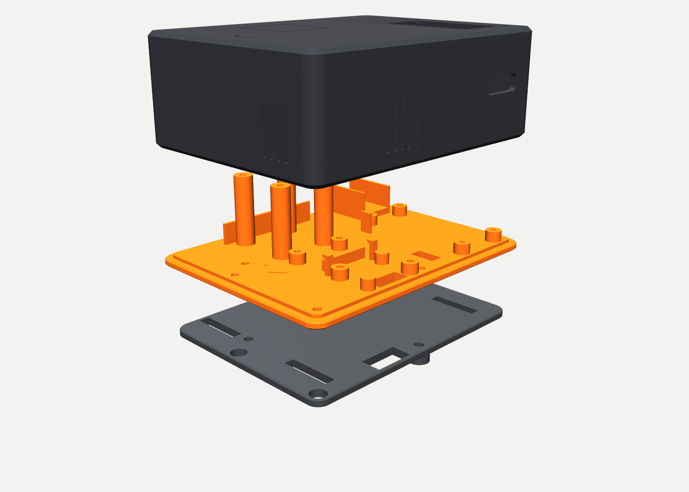
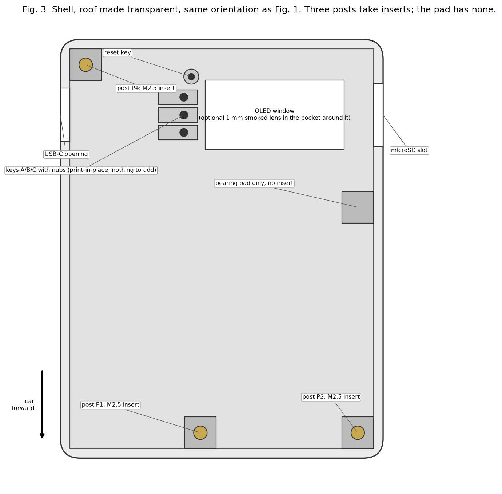
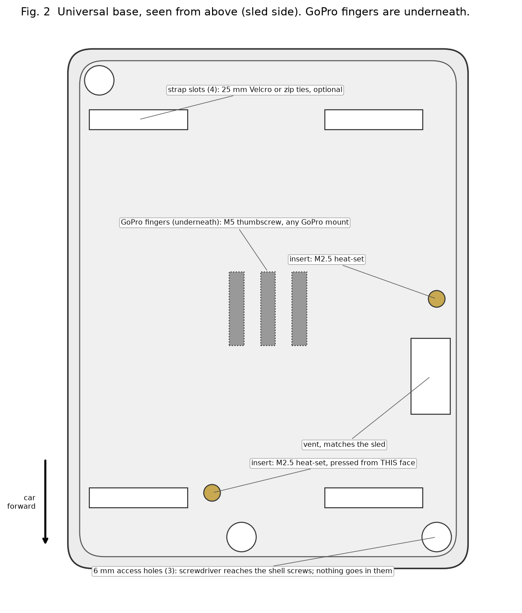
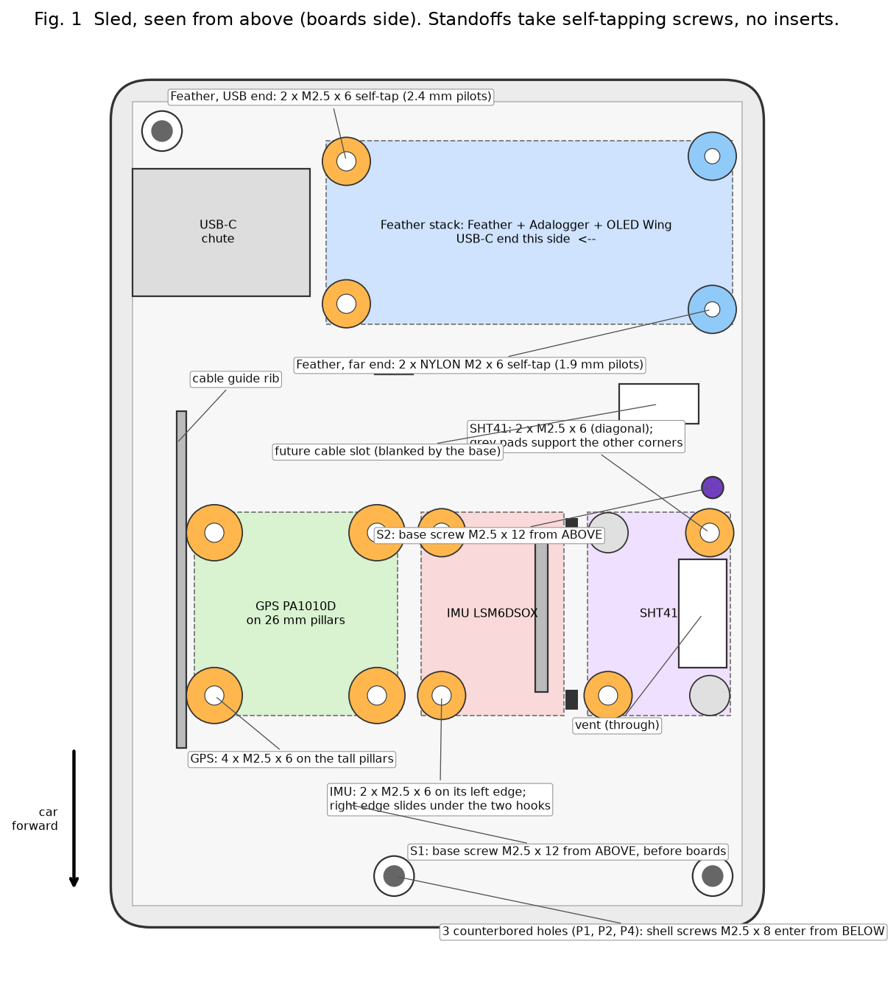
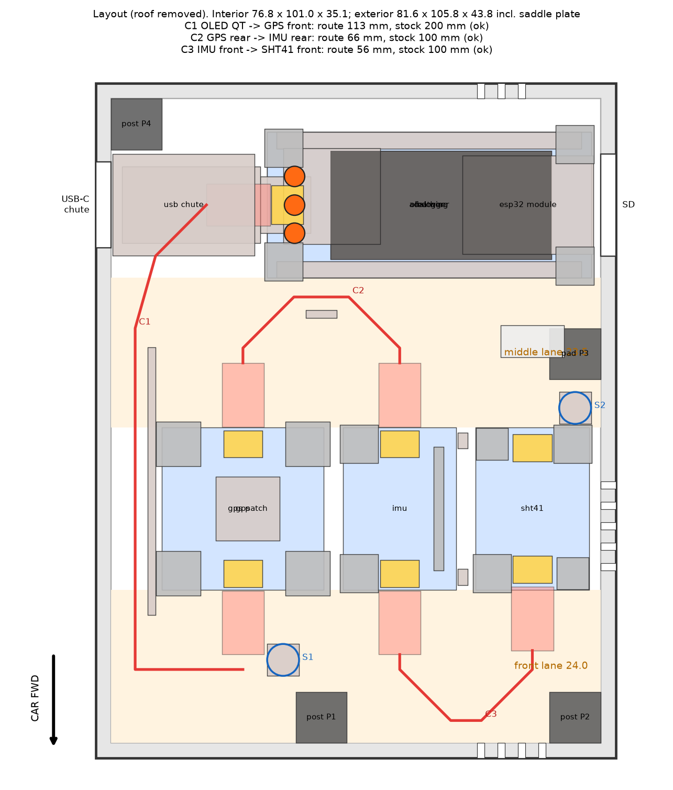
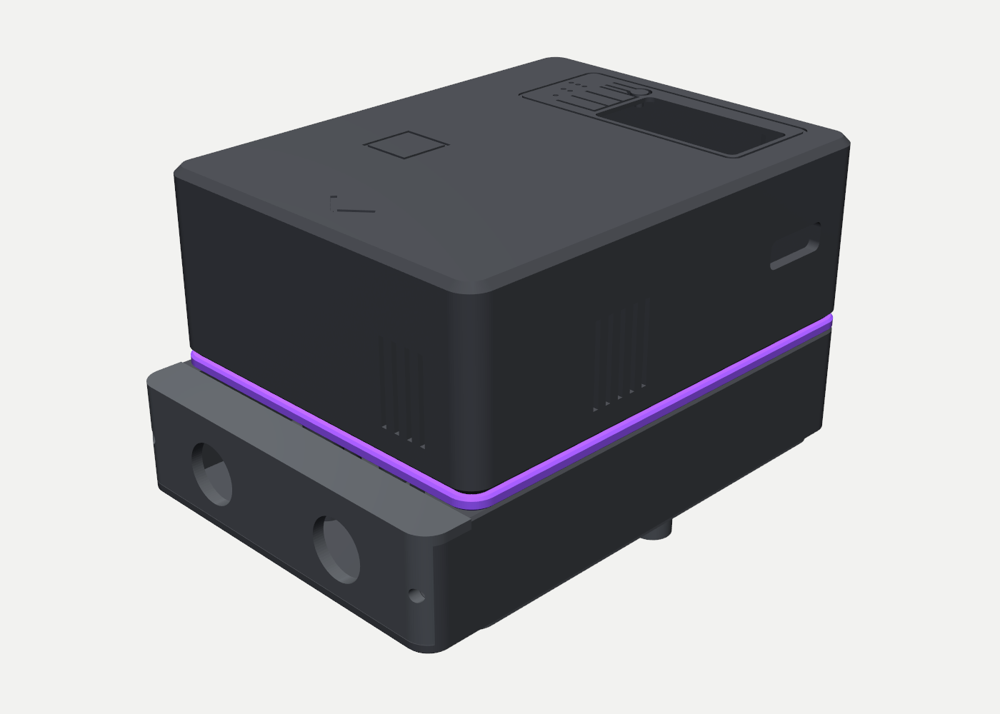
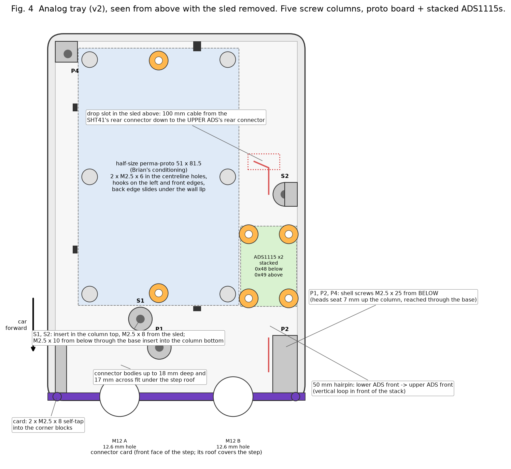
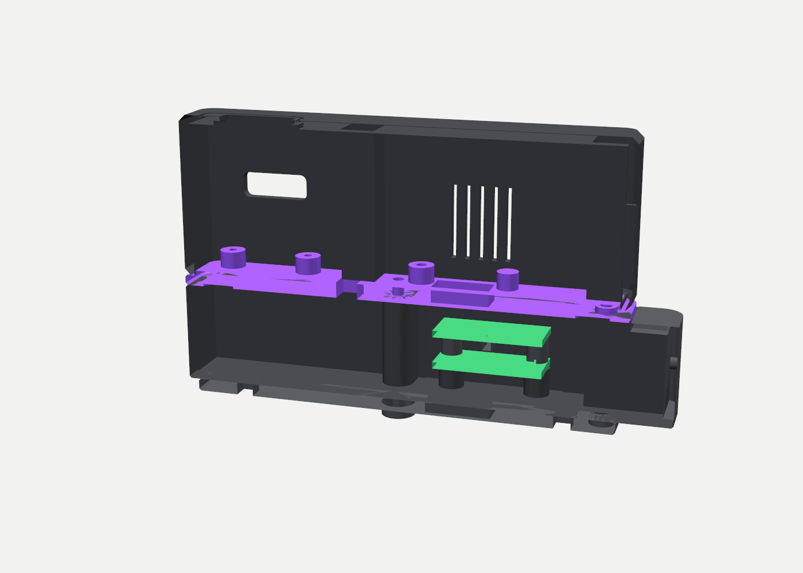

# Race logger enclosure: build and assembly guide (v1 GoPro base; section 8 adds the v2 analog tray)

Everything here is derived from `mechanical/generate_onshape.py`; the figures in `docs/assembly/` are drawn from the same
coordinates, so a label on a figure is the truth about that hole. Read this once end to end before pressing the first insert.

## 1. Parts

### Printed parts (ASA, Bambu P1S, 0.2 mm layers, 4 walls, elephant-foot compensation on)
| Part | File | Colour | On the plate | Notes |
|---|---|---|---|---|
| Shell | `mechanical/output/shell.stl` | dark gray + purple | roof DOWN, 5 mm brim | filament change to purple at layer 3, back to gray at layer 5; this colours every roof engraving |
| Sled | `mechanical/output/sled.stl` | purple | plate down | its exposed edge is the accent band |
| Universal base | `mechanical/output/universal_base_(gopro).stl` | dark gray | plate down, fingers up | GoPro 3-finger mount |
| Test coupon (first!) | `mechanical/output/test_coupon.stl` | any | roof down | verifies insert bore, screw pilots and key flaps for your inserts and printer |

Later, for the roll-bar version: `saddle.stl` (plate down) and `clamp_cap.stl` (standing on end). Both replace the universal base and add 4 inserts and 4 screws.

### Hardware
| Item | Spec | Qty | Where |
|---|---|---|---|
| Heat-set inserts | M2.5, 4 mm long, 3.5 mm OD (bores are 3.4 mm) | **5** | 3 shell posts, 2 base bosses |
| Screws, shell | M2.5 x 8 | 3 | up through base access holes and sled counterbores into the shell posts |
| Screws, base | M2.5 x 12 | 2 | down through the sled into the base inserts |
| Screws, boards | M2.5 x 6, self-tapping into 2.4 mm pilots | 10 | Feather USB end (2), GPS (4), IMU (2), SHT41 (2) |
| Screws, Feather far end | **nylon** M2 x 6, self-tapping into 1.9 mm pilots | 2 | steel here sits 2 mm from the ESP32 antenna |
| GoPro thumbscrew | M5 x 20 GoPro type | 1 | between the base fingers and any GoPro mount |
| STEMMA QT cables | 200 mm (1), 100 mm (2) | 3 | see section 4 |
| Coin cell | CR1220 | 1 | Adalogger RTC |
| Optional | 1 mm smoked polycarbonate lens, ~40 x 20 mm | 1 | roof inner pocket, thin double-sided tape on the long edges |
| Optional | 3M bumpon feet, 8 mm | 4 | recesses under the sled for bench use without the base |

Electronics: ESP32-S3 Feather (5477), Adalogger FeatherWing (2922) with stacking headers, assembled OLED FeatherWing 128x64 (6313), PA1010D GPS (4415), LSM6DSOX (4438), SHT41 (5776), two sets of Feather stacking headers (2830).

### Tools
Soldering iron (a flat or insert tip, ~250 C for ASA), small Phillips or hex driver for M2.5, flush cutters for the Feather header tails, calipers if you want to check the coupon.

## 2. Coupon first (15 minutes)
Print `test_coupon.stl` roof-down in the same ASA you'll use for the shell. It carries three insert bores (3.4 / 3.6 / 3.8 mm), five screw pilots (1.6 / 1.75 / 2.0 / 2.2 / 2.4 mm) and three flexure keys with nubs.
- Insert bore: the right size lets only the tapered nose in cold; the body must not slide in. Heat-set one and check it holds an M2.5 screw. Expected: 3.4 for 3.5 mm OD inserts.
- Pilots: M2.5 should self-tap the 2.4 hole with moderate effort and hold; the tower must not split. Nylon M2 should bite in 1.75 to 2.0.
- Keys: press each flap with a fingernail; it should move about half a millimetre and spring back.
If anything disagrees, change `INSERT_D`, `HOLE_M25` or `HOLE_M2` in the generator and re-export before printing the big parts.

## 3. Prepare the parts

1. **Shell, 3 inserts.** With the shell open side up, press an M2.5 insert into each of the three posts (P1 and P2 along the front wall, P4 in the back-left corner). The fourth block on the right wall is a bearing pad and has no bore. The bores are 3.4 mm with a 3.6 mm lead-in: the insert will not drop in cold, the iron seats it flush. Keep the iron vertical; posts are 8 mm square with 2.3 mm walls.
2. **Base, 2 inserts.** Press an M2.5 insert into each of the two bores from the top face (the face the sled sits on). Fig. 2 shows them: front-left and right edge, mid-length.
3. **Feather header tails.** The stacking-header tails under the Feather are 11.4 mm long as supplied. Trim them to 3 mm or less; the standoffs give 4 mm.
4. **Stack the boards** with the Adalogger on the Feather and the OLED Wing on top (12.7 mm per level, 27 mm Feather-bottom to OLED-top). Fit the CR1220.

## 4. Assemble

1. **Sled onto base.** Lay the sled on the base, purple band overhanging the gray plate evenly. The two plain 2.7 mm holes in the sled land over the base inserts (S1 near the front-left, S2 at the right edge). Drive two **M2.5 x 12** down from the sled's top face. These are the only screws that go in before the boards, and you shouldn't need them again unless you swap to the roll-bar saddle.
2. **IMU.** Slide the board's right edge under the two hooks, drop the left edge onto its two standoffs, 2 x M2.5 x 6. The ledge under the right edge supports it.
3. **SHT41.** Onto its two standoffs and two plain pads at the front-right, 2 x M2.5 x 6 in the diagonal holes. The vent slot is under it; leave it clear.
4. **Feather stack.** Onto the four stack standoffs, USB-C toward the chute. 2 x M2.5 x 6 at the USB end, 2 x **nylon M2 x 6** at the far end.
5. **GPS.** Onto the four tall pillars, patch antenna up, connectors facing front and back. 4 x M2.5 x 6.
6. **Cables** (all JST SH, no latches, push until they click):
   - **200 mm**: OLED Wing's connector on its underside at the USB end, out toward the left wall, turn toward the front, run along the left wall at the GPS's height, U-turn in the front lane into the GPS **front** connector. Fold the ~60 mm of slack flat against the left wall between the wall and the tall rib.
   - **100 mm**: GPS **rear** connector, U-turn through the middle lane (the short rib guides the straight run), descending to the IMU **rear** connector.
   - **100 mm**: IMU **front** connector, U-turn along the front wall into the SHT41 **front** connector. The SHT41's rear connector stays empty.
   For car use, a dab of hot glue on each plug housing stops vibration walking them out.
7. **Shell on.** Lower the shell straight down over the sled; its walls drop around the raised plateau. Turn the assembly over and drive three **M2.5 x 8** up through the base's 6 mm access holes, through the sled's counterbores, into the shell posts. Snug, not tight.
8. **Mount.** Any GoPro mount onto the three fingers with the M5 thumbscrew. The chevron on the roof points to the front of the car.

## 5. Checks before the first drive
- All four keys click their switches and return; if one feels pre-pressed, sand its nub (the small cylinder under the flap) a few strokes.
- USB-C plug seats through the chute; the receptacle is 26 mm in, guided.
- Nothing rattles when shaken; boards are tight, cables tied down.
- The GPS gets a fix outdoors within a couple of minutes.
- Orientation calibration in firmware: capture gravity at rest for pitch and roll, a straight-line acceleration for yaw.

## 6. Service
Shell off: three screws from below through the base's access holes. Everything, including cables and the SD card, is reachable with the shell off and the sled still mounted. Reset is the round key on the roof.

## 7. Roll-bar version (later)
Print `saddle.stl` and `clamp_cap.stl` (set `tubeDia` in the Onshape feature to your bar). Press 2 inserts into the saddle plate's top face and 4 into the cradle ears from below. The saddle replaces the base with the same two M2.5 x 12; the cap takes 4 x M2.5 x 12 up through its flanges. Line the cradle with a 1 mm rubber strip.

## 8. Analog tray (v2): two ADS1115s and a proto board under the logger

The tray slides between the sled and the base. Nothing already printed changes: shell, sled and base are reused, and every screw comes from the
owned kit. The three shell screws become M2.5 x 25 and clamp shell, sled and tray; two M2.5 x 8 tie the sled to inserts in the tray's column tops;
two M2.5 x 10 from below tie the tray to the base through the base's own inserts. The tray adds 23.5 mm of height and a 10.4 mm step at the front whose
face is a removable connector card. Inside: a half-size solderable breadboard (DIKAVS or Adafruit Perma-Proto, 51 x 81.5 mm) for the signal
conditioning, and the two ADS1115 STEMMA QT boards stacked two high beside it. Bench use without analog inputs: leave the tray off and use the v1 screws.

### Printed parts (ASA, same settings as the rest)
| Part | File | On the plate | Notes |
|---|---|---|---|
| Analog tray | `mechanical/output/analog_tray.stl` | floor down, open side up | no supports; the horizontal card-screw pilots print as 2.4 mm holes in the corner blocks; the three 5 mm holes in the floor are the shell-screw driver channels |
| Connector card, 2 x M12 | `mechanical/output/connector_card_(2x_m12).stl` | face down, roof flange standing | 12.6 mm holes for M12 panel receptacles (GX12 also fits). Change `CONNECTORS` in the generator for other layouts |
| Connector card, blank | `mechanical/output/connector_card_(blank).stl` | face down | drill your own, or print it to close the step while the harness is undecided |
| ADS riser frame | `mechanical/output/ads_riser_frame.stl` | bars down, sleeves up | sits on the lower ADS1115; the upper board rests on it |

### Hardware (in addition to section 1)
| Item | Spec | Qty | Where |
|---|---|---|---|
| Shell screws | M2.5 x 25 (replace the 3 x M2.5 x 8) | 3 | P1, P2, P4 from below; heads seat 7 mm up inside the tray columns, 4.8 mm of thread in the shell inserts |
| Sled screws | M2.5 x 8 (replace the 2 x M2.5 x 12) | 2 | S1, S2 from the sled top into inserts pressed into the tray's column tops |
| Inserts | M2.5 x 4, 3.5 mm OD (same as before) | 2 | tray column tops at S1, S2 |
| Base screws | M2.5 x 10 | 2 | from BELOW through the base's S1/S2 inserts into 2.4 mm pilots in the tray's column bottoms (drill the two blind bores through first, see step 0) |
| ADS stack screws | M2.5 x 16 | 4 | down through the upper ADS1115, the riser sleeves and the lower ADS1115 into the 6.5 mm tray standoffs (8 mm pilots) |
| Proto screws | M2.5 x 6 | 2 | the proto's two 3.2 mm centreline holes (M3 x 6 also works; pilots are 2.4 mm) |
| Card screws | M2.5 x 8 self-tap | 2 | from the front, 3 mm in from each end of the card, into the corner blocks |
| Boards | ADS1115 STEMMA QT ([Adafruit 1085](https://www.adafruit.com/product/1085)) | 2 | lower = address 0x48 (default), upper = 0x49 (bridge the ADDR solder jumper to VDD before stacking) |
| Proto board | DIKAVS Perma-Proto half size, 51 x 81.5, or Adafruit 571 | 1 | Brian's conditioning: dividers, filters, clamps, excitation; pluggable terminals fit (13 mm of headroom) |
| Panel connectors | M12 8-pin A-coded panel receptacles, solder cup, rear or front mount, nut and flange up to 17 mm, body up to 18 mm behind the card | 2 | the card; one for the engine-bay harness, one for the console |
| STEMMA QT cables | 100 mm (1), 50 mm (1) | 2 | see below |

### Order

0. **Base prep (once).** The base's two insert bores are blind; 1 mm of plastic sits under each insert. From the top, run a 2.7 mm (7/64 in) drill down through the insert and out the boss underneath. The insert guides the bit. This lets the tray screws come up from below.
1. **Set addresses.** On one ADS1115 bridge the ADDR jumper to VDD (0x49). That one goes on top.
2. **Lower ADS1115.** Onto the four 6.5 mm standoffs in the strip right of the proto area (two are D-shaped toward the proto, two merge into the wall), connectors facing front and back. Do not screw it yet.
3. **Riser and upper ADS1115.** Riser frame onto the lower board (bars up, the notched sleeve foot over the lower board's LED, front-right corner), upper board onto the riser. Four M2.5 x 16 through everything into the standoffs; they engage 6.9 mm of an 8 mm pilot, so stop when snug. The upper board's connectors face the same way.
4. **Hairpin.** 50 mm cable from the lower board's FRONT connector to the upper board's FRONT connector. It forms a 10 mm loop in front of the stack, inside the step.
5. **Proto board.** Slide its back edge under the lip on the back wall, lower the front edge past the three hooks (two on the left edge, one on the front) until they click over the board. Two M2.5 x 6 into the centreline standoffs. The board sits on six pads; it must not rock.
6. **Connector card.** Fit the panel receptacles to the card (nuts outside), lead the solder tails into the tray, screw the card on with two M2.5 x 8 from the front. The card's roof covers the step; the sled will sit on the walls behind it.
7. **Harness to the proto.** Solder the receptacle tails to the proto. Tie the bundle to the floor with a zip tie through the gap under the proto if it is long.
8. **Tray inserts.** Press one M2.5 insert into the top of each S column (S1 front-left, S2 right-middle), same 3.4 mm bore and lead-in as the shell posts.
9. **Tray onto base.** Tray onto the base, its five columns over the base's two insert bosses and three access holes, step overhanging the front. Turn the pair over and drive two **M2.5 x 10** up through the base inserts into the column bottoms. Snug; these are self-tapping into 2.4 mm pilots.
10. **Sled onto tray.** Sled onto the tray's rim, purple band overhanging. Two **M2.5 x 8** down through S1 and S2 into the new inserts.
11. **Drop cable.** Before the boards go on the sled: feed the 100 mm cable through the sled's drop slot (middle lane, right side, behind the SHT41 position) and plug it into the UPPER ADS1115's REAR connector. Do this as you lower the sled in step 10. The other end plugs into the SHT41's rear connector once the SHT41 is mounted. Coil the slack flat in the strip behind the stack.
12. Sled boards and cables as in section 4, then the shell. The three shell screws are now **M2.5 x 25** from below: through the base's access hole, up the 5 mm channel in the tray column, through the sled into the shell post. A 2 mm hex key or a long-shaft driver reaches the head 7 mm up the channel.

### Checks
- The upper ADS1115's connector housings clear the sled plate by about 0.9 mm; if the stack rattles, the riser is upside down.
- Service from below, as in v1: three M2.5 x 25 release the shell; two M2.5 x 10 release the tray from the base. The sled stays on the tray unless you take out the two S screws from inside.
- Both ADS1115s appear on the I2C scan at 0x48 and 0x49. If only one appears, the hairpin is not clicked in.
- Connector nuts tight, card screws tight, proto does not move under a fingertip. The IMU in the box above sees the whole stack as one rigid body only if every one of the five long screws is snug.

### Alternative: header-type ADS1115 modules on the proto board
Generic ADS1115 modules (blue board, 10-pin header, about 20 x 30 mm, e.g. the Weewooday 6-pack; check reviews confirm real 16-bit parts) work just as well
electrically but have no STEMMA QT sockets and do not fit the tray's stack mounts. Mount them on the perma-proto instead: solder the header in so the module
stands on it, bus SDA / SCL / VDD / GND across the proto, ADDR to GND on one (0x48) and to VDD on the other (0x49), and a bead of hot glue along the free edge
of each module against vibration. Feed I2C with a 150 mm JST SH to header pigtail: QT end in the SHT41's rear connector, down the drop slot, header end on the
proto's I2C rail. Skip the riser frame and the four stack screws; the tray's ADS standoffs stay unused. Their 10k pullups add to the bus (about 1.7k total
with the four Adafruit boards), fine at 3.3 V; remove one module's pullups if the bus ever misbehaves.

### Changing connectors later
Edit `CONNECTORS` in `mechanical/generate_onshape.py` (x position, hole diameter, label), regenerate, print only the card (15 minutes). The clearance check knows about the P1 column and the ADS hairpin, so it will refuse layouts whose bodies collide. Bodies up to 18 mm behind the card and 19 mm across fit under the step roof; GX16 (19 mm nut, 21 across corners) is marginal, M12 and GX12 fit.
